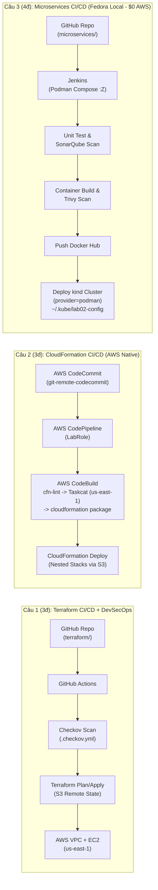

# NT548 — Bài Tập Thực Hành 02: Tự Động Hóa Hạ Tầng AWS & CI/CD Microservices (DevSecOps)

> **Môn học:** Công nghệ DevOps và Ứng dụng (`NT548`)  
> **Khoa:** Mạng máy tính và Truyền thông — Trường Đại học Công nghệ Thông tin (UIT - ĐHQG-HCM)  
> **Giảng viên hướng dẫn:** ThS. Lê Anh Tuấn  
> **Hạ tầng thực hành:** AWS Academy Learner Lab (`us-east-1`, 50 USD) cho Câu 1 & Câu 2 | Fedora Local (Podman Compose + `kind`) cho Câu 3

---

## 1. Thông Tin Nhóm Thực Hiện (4 Thành Viên)

| STT | MSSV | Họ và Tên | Vai Trò | Phụ Trách Chính |
| :-: | :---: | :--- | :--- | :--- |
| 1 | `23521367` | **Ngô Tiến Sỹ** | **Tech Lead** | GitHub Actions + Checkov (Câu 1), CodeCommit/CodeBuild/CodePipeline (Câu 2), Jenkins + SonarQube + Trivy + Podman/`kind` (Câu 3) |
| 2 | `23521222` | **Trần Hồng Phúc** | **App Dev & Test Support** | Phát triển app microservices mẫu (2–3 service nhẹ Python/Node.js + `/health` + unit test + `Dockerfile` non-root), hỗ trợ kiểm thử theo `RUNBOOK.md` |
| 3 | `23520600` | **Điền Quốc Huy** | **QA & Evidence** | Kiểm thử hoạt động 3 pipeline CI/CD & dịch vụ trên `kind`, chụp & chuẩn hóa toàn bộ ảnh minh chứng vào `docs/evidence/` |
| 4 | `22520804` | **Đặng Thế Long** | **Diagrams, Report & Docs** | Vẽ sơ đồ 3 pipeline CI/CD (Draw.io), chủ trì Báo cáo Word Lab 02 (3 câu), rà soát `README.md` và cập nhật `WBS.md` |

---

## 2. Phạm Vi & Thang Điểm Đề Bài

| Câu | Nội Dung Cốt Lõi | Công Cụ Chính | Điểm |
| :-: | :--- | :--- | :-: |
| **Câu 1** | Kế thừa hạ tầng Terraform từ Lab 01, tự động hóa CI/CD & quét tuân thủ bảo mật | Terraform (S3 Remote State), GitHub Actions, **Checkov** | **3.0** |
| **Câu 2** | Kế thừa hạ tầng CloudFormation từ Lab 01, tự động hóa kiểm tra & triển khai trên AWS | AWS CodeCommit, AWS CodeBuild (**cfn-lint**, **Taskcat**, `package`), AWS CodePipeline | **3.0** |
| **Câu 3** | Xây dựng pipeline CI/CD cho ứng dụng microservices (build, test, quét chất lượng & bảo mật, deploy) | **Jenkins**, **SonarQube**, **Trivy** (tùy chọn nâng cao), **Docker Hub**, **Podman Compose (`:Z`)**, **`kind` (`~/.kube/lab02-config`)** | **4.0** |

---

## 3. Kiến Trúc Tổng Thể 3 Pipeline



### Các Nguyên Tắc Kỹ Thuật Bắt Buộc
1. **Câu 1 — Bắt buộc S3 Remote State:** GitHub Runner bị xóa sau mỗi lần chạy; dùng S3 backend (`use_lockfile = true`, không cần DynamoDB) để đảm bảo luôn chạy được `terraform destroy` tự động, không bỏ sót NAT Gateway gây cạn 50 USD.
2. **Câu 2 — `git-remote-codecommit` + `package` + Taskcat `us-east-1`:** Learner Lab không cho tạo IAM User (nên không có Git HTTPS credentials tĩnh) → đẩy code lên CodeCommit qua `git-remote-codecommit`. CodeBuild chạy `cfn-lint` → `taskcat` (chỉ 1 region `us-east-1`) → `aws cloudformation package` để CodePipeline triển khai được Nested Stacks bằng `LabRole`. Nếu Learner Lab chặn quyền CodeCommit/CodePipeline, chuyển sang phương án dự phòng GitHub/S3 Source và ghi rõ bằng chứng trong báo cáo.
3. **Câu 3 — Cách ly tuyệt đối Kubernetes & chuẩn SELinux Fedora:**
   - Toàn bộ stack Jenkins + SonarQube chạy local bằng **Podman Compose** với nhãn volume **`:Z`** cho SELinux.
   - Cụm Kubernetes dùng **`kind`** với `KIND_EXPERIMENTAL_PROVIDER=podman` và xuất kubeconfig riêng ra **`~/.kube/lab02-config`** — **tuyệt đối không chạm vào `~/.kube/config` mặc định** của cụm 3-node sẵn có.

---

## 4. Cấu Trúc Thư Mục Dự Kiến

```text
nt548-lab2/
├── README.md                            # Tài liệu tổng quan & hướng dẫn chấm bài
├── RUNBOOK.md                           # Sổ tay vận hành chi tiết 3 câu (SOP) & Git cheatsheet
├── WBS.md                               # Phân rã công việc & lịch trình 21/11/2026 - 10/12/2026
├── .gitignore                           # Chặn state, secrets, taskcat_outputs, lab02-config, build cache
├── .github/
│   └── workflows/
│       └── terraform.yml                # Câu 1: Checkov + Terraform Plan/Apply + Manual Destroy
├── terraform/                           # Câu 1: Kế thừa Lab 01 + S3 backend + Hardening + .checkov.yml
│   ├── backend.tf
│   ├── main.tf
│   ├── variables.tf
│   ├── outputs.tf
│   ├── .checkov.yml
│   └── modules/
├── cloudformation/                      # Câu 2: Kế thừa Lab 01 + CodeBuild + Taskcat
│   ├── main.yaml
│   ├── templates/
│   ├── buildspec.yml                    # cfn-lint -> taskcat -> aws cloudformation package
│   └── .taskcat.yml                     # Khóa region: us-east-1
├── microservices/                       # Câu 3: 2-3 service mẫu nhẹ (Python/Node.js)
│   ├── Jenkinsfile                      # Declarative Pipeline (Test -> SonarQube -> Build -> Trivy -> Push -> Deploy)
│   ├── service-a/                       # Service 1 (code, unit test, Dockerfile)
│   ├── service-b/                       # Service 2 (code, unit test, Dockerfile)
│   ├── api-gateway/                     # Service 3 / Gateway (tùy chọn)
│   └── k8s/                             # Kubernetes Deployment, Service manifests
├── infra-local/                         # Câu 3: Hạ tầng CI/CD local trên Fedora
│   ├── podman-compose.yml               # Jenkins + SonarQube + PostgreSQL (bind mount :Z)
│   ├── jenkins/                         # Custom Jenkins image (kubectl, trivy, sonar-scanner, podman/buildah)
│   └── kind-config.yaml                 # Cấu hình cụm kind chạy trên Podman
└── docs/
    ├── diagrams/                        # Sơ đồ 3 pipeline CI/CD
    ├── evidence/                        # Ảnh minh chứng chia theo q1/, q2/, q3/
    └── report/                          # Bản thảo & file Báo cáo Word hoàn chỉnh
```

---

## 5. Yêu Cầu Môi Trường

### Chung (Câu 1 & Câu 2 — AWS Academy Learner Lab)
- **AWS CLI v2** (`>= 2.15`), cấu hình `region = us-east-1`.
- **Terraform** (`>= 1.10`) & **Checkov** (`pip install --user checkov`).
- **CloudFormation tools:** `cfn-lint`, `taskcat`, `git-remote-codecommit` (`pip install --user cfn-lint taskcat git-remote-codecommit`).
- **GitHub Repository Secrets** (cập nhật mỗi phiên 4h): `AWS_ACCESS_KEY_ID`, `AWS_SECRET_ACCESS_KEY`, `AWS_SESSION_TOKEN`, `TF_STATE_BUCKET`, `MY_IP_CIDR`, `EC2_KEY_NAME`.

### Riêng Câu 3 (Host Fedora Local)
- **Podman** + **Podman Compose** (`podman-compose`), kích hoạt `podman.socket` user service.
- **kind** (`>= 0.24`) chạy với `KIND_EXPERIMENTAL_PROVIDER=podman`.
- **kubectl** (luôn chỉ định `--kubeconfig ~/.kube/lab02-config`).
- **Trivy** (`trivy`) & tài khoản **Docker Hub** (Access Token).
- Tham số kernel cho SonarQube: `vm.max_map_count >= 262144`.

---

## 6. Hướng Dẫn Chạy & Kiểm Tra Kết Quả Theo Từng Câu

> Xem từng bước chi tiết, lệnh mẫu và cách xử lý sự cố tại [RUNBOOK.md](./RUNBOOK.md).

### 6.1. Câu 1 — Terraform + GitHub Actions + Checkov (3 điểm)
1. Tạo S3 bucket lưu Remote State (`nt548-lab2-tfstate-<account-id>-us-east-1`).
2. Cập nhật 3 khóa STS tạm thời từ Learner Lab vào **GitHub Actions Secrets**.
3. Push code (hoặc mở Pull Request) → GitHub Actions chạy **Checkov** + `terraform plan`.
4. Merge vào `main` → tự động chạy `terraform apply -auto-approve`.
5. Xác minh hạ tầng trên AWS Console/CLI, chụp ảnh minh chứng, sau đó chạy ngay workflow **`workflow_dispatch` → `action=destroy`** để xóa sạch tài nguyên.

### 6.2. Câu 2 — CloudFormation + CodeCommit + CodeBuild + CodePipeline (3 điểm)
1. Tạo repo CodeCommit `nt548-lab2-cfn` trên `us-east-1` và đẩy thư mục `cloudformation/` qua `git-remote-codecommit`:
   ```bash
   git remote add codecommit codecommit::us-east-1://nt548-lab2-cfn
   git push codecommit main
   ```
2. Tạo CodeBuild Project & CodePipeline (Source → Build/Test → Deploy CloudFormation) sử dụng **`LabRole`**.
3. Pipeline tự chạy `cfn-lint` → `taskcat` (giới hạn `us-east-1`) → `aws cloudformation package` → triển khai Nested Stacks.
4. Kiểm tra Stack `CREATE_COMPLETE`, chụp minh chứng, rồi xóa cả Production Stack lẫn mọi Taskcat stack mồ côi (nếu có).

### 6.3. Câu 3 — Jenkins + SonarQube + Trivy + Podman/`kind` (4 điểm)
1. Chuẩn bị `vm.max_map_count=262144` và khởi động Jenkins + SonarQube bằng `podman-compose -f infra-local/podman-compose.yml up -d` (mọi bind mount dùng `:Z`).
2. Tạo cụm `kind` **cách ly hoàn toàn**:
   ```bash
   KIND_EXPERIMENTAL_PROVIDER=podman kind create cluster \
     --name nt548-lab2 \
     --config infra-local/kind-config.yaml \
     --kubeconfig ~/.kube/lab02-config
   ```
3. Kích hoạt Pipeline trên Jenkins → theo dõi đủ các stage: **Checkout → Unit Test & SonarQube → Build Image & Trivy Scan → Push Docker Hub → Deploy `kind`**.
4. Kiểm tra ứng dụng chạy trên cụm `kind` riêng:
   ```bash
   kubectl --kubeconfig ~/.kube/lab02-config get pods,svc -A
   ```
5. Dọn dẹp sau khi chụp minh chứng: `kind delete cluster --name nt548-lab2` và `podman-compose down`.

---

## 7. Tài Liệu Liên Quan

- **Sổ tay vận hành 3 câu & Git Cheatsheet cho nhóm:** [RUNBOOK.md](./RUNBOOK.md)
- **Phân rã công việc & lịch trình (21/11/2026 – 10/12/2026):** [WBS.md](./WBS.md)
- **Kho mã nguồn nền tảng (Lab 01 — Terraform & CloudFormation):** `nt548-lab1`
