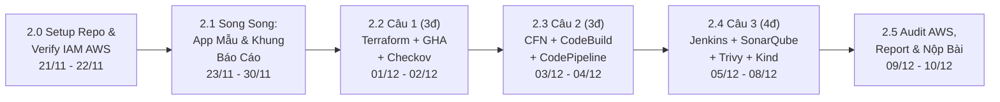

# WBS — Work Breakdown Structure (NT548 Lab 02)

> **Khung thời gian tổng thể (Lab 01 + Lab 02):** `21/11/2026` (Thứ Bảy) → `10/12/2026` (Thứ Năm) — **20 ngày**  
> **Chuẩn bị song song (App mẫu & Khung báo cáo):** `23/11/2026` → `30/11/2026` (trong lúc Tech Lead hoàn thiện Lab 01)  
> **Trọng tâm kỹ thuật Lab 02:** `01/12/2026` → `08/12/2026` | **Audit & Nộp bài:** `09/12/2026` → `10/12/2026`

---

## 1. Phân Vai Nhóm 4 Thành Viên

| Mã | MSSV | Họ và Tên | Vai Trò | Trách Nhiệm Chính Trong Lab 02 |
| :-: | :---: | :--- | :--- | :--- |
| **TV1** | `23521367` | **Ngô Tiến Sỹ** | **Tech Lead** | Câu 1 (Terraform S3 state, Checkov, GitHub Actions), Câu 2 (CodeCommit, CodeBuild `cfn-lint`/`Taskcat`/`package`, CodePipeline), Câu 3 (Podman Compose `:Z`, `kind` `~/.kube/lab02-config`, Jenkinsfile, SonarQube, Trivy) |
| **TV2** | `23521222` | **Trần Hồng Phúc** | **App Dev & Test Support** | Phát triển app microservices mẫu 2–3 service nhẹ (Python/Node.js + `/health` + unit test + `Dockerfile` non-root), hỗ trợ kiểm thử 3 pipeline theo `RUNBOOK.md` |
| **TV3** | `23520600` | **Điền Quốc Huy** | **QA & Evidence** | Kiểm thử 3 pipeline CI/CD & microservices trên `kind`, chụp & chuẩn hóa đầy đủ ảnh minh chứng vào `docs/evidence/{q1,q2,q3}/` |
| **TV4** | `22520804` | **Đặng Thế Long** | **Diagrams, Report & Docs** | Vẽ sơ đồ 3 pipeline CI/CD (Draw.io), chủ trì Báo cáo Word Lab 02 (mẫu Khoa MMT&TT, bảng **4 thành viên**), hoàn thiện `README.md` và cập nhật `WBS.md` |

---

## 2. Lộ Trình Triển Khai Lab 02 (`21/11/2026` → `10/12/2026`)

---

## 3. Bảng Phân Rã Công Việc Chi Tiết (Work Packages)

> Ký hiệu: **R** = Chịu trách nhiệm chính (Responsible), **S** = Hỗ trợ (Support).

| Mã WBS | Giai Đoạn & Đầu Việc | Thời Gian | R | S | Sản Phẩm Đầu Ra (Deliverable) | Định Nghĩa Hoàn Thành (DoD) | Trạng Thái |
| :---: | :--- | :---: | :-: | :-: | :--- | :--- | :---: |
| **2.0** | **Khởi Tạo Repo & Kiểm Thử Quyền AWS Learner Lab** | **21/11 – 22/11** | | | | | |
| 2.0.1 | Tạo repo GitHub `nt548-lab2`, đẩy 4 file nền (`README.md`, `RUNBOOK.md`, `.gitignore`, `WBS.md`), thêm 3 thành viên | 21/11 – 22/11 | TV1 | TV4 | Repo GitHub có commit khởi tạo | 4 thành viên clone thành công | `[ ]` |
| 2.0.2 | Chạy `SOP 0.1` kiểm tra thực tế quyền `LabRole` cho CodeCommit, CodeBuild, CodePipeline, CloudFormation trên `us-east-1` | 22/11 | TV1 | — | Ghi chú xác nhận quyền / phương án dự phòng Câu 2 | Biết trước có cần fallback hay không trước ngày 03/12 | `[ ]` |
| **2.1** | **Chuẩn Bị Song Song (Trong Lúc Tech Lead Làm Lab 01)** | **23/11 – 30/11** | | | | | |
| 2.1.1 | Chuẩn bị ứng dụng microservices mẫu gồm 2–3 service nhẹ (VD: `user-service`, `order-service`, `gateway` bằng Python FastAPI hoặc Node.js Express), có health check `/health`, unit tests & `Dockerfile` | 23/11 – 28/11 | TV2 | TV1 | `microservices/service-*` | Chạy được local bằng Podman/Docker, unit tests PASS 100% | `[ ]` |
| 2.1.2 | Dựng khung Báo cáo Word Lab 02 theo mẫu PDF (mở rộng bảng lên **4 thành viên**, cấu trúc sẵn Câu 1, Câu 2, Câu 3) | 26/11 – 28/11 | TV4 | — | `docs/report/NT548-Lab02-Report-Draft.docx` | Đúng mẫu Khoa MMT&TT | `[ ]` |
| 2.1.3 | Tech Lead review app microservices mẫu (tối ưu Dockerfile multi-stage, kích thước image nhỏ để giảm cảnh báo Trivy & SonarQube) | 29/11 – 30/11 | TV1 | TV2 | `microservices/` sẵn sàng cho Câu 3 | Build nhanh, không lộ secret, có file test coverage cho SonarQube | `[ ]` |
| **2.2** | **Câu 1 (3đ): Terraform + GitHub Actions + Checkov** | **01/12 – 02/12** | | | | | |
| 2.2.1 | Kế thừa Terraform modules từ `nt548-lab1`, cấu hình **S3 Remote State** (`use_lockfile = true`), hardening code & tạo `.checkov.yml` | 01/12 | TV1 | — | `terraform/backend.tf`, `terraform/.checkov.yml` | `checkov -d terraform/` pass sạch các rule trọng yếu | `[ ]` |
| 2.2.2 | Viết `.github/workflows/terraform.yml` (Checkov + `plan` trên PR, `apply` trên `main`, `workflow_dispatch` hỗ trợ `destroy`), nạp 3 AWS Secrets | 01/12 – 02/12 | TV1 | TV2 | `.github/workflows/terraform.yml` | Pipeline chạy xanh end-to-end (Checkov → Plan → Apply → Destroy) | `[ ]` |
| 2.2.3 | Kiểm chứng hạ tầng tạo bởi GHA, chụp bộ ảnh `q1-01` → `q1-06`, chạy workflow `destroy` & xác minh AWS sạch 0 NAT GW / 0 EIP | 02/12 | TV3 | TV1, TV2 | `docs/evidence/q1/*.png` | Toàn bộ ảnh rõ nét; hạ tầng AWS đã hủy hoàn toàn | `[ ]` |
| **2.3** | **Câu 2 (3đ): CloudFormation + CodeCommit + CodeBuild + CodePipeline** | **03/12 – 04/12** | | | | | |
| 2.3.1 | Kế thừa CloudFormation Nested Stacks từ `nt548-lab1`, viết `.taskcat.yml` (khóa `us-east-1`) & `buildspec.yml` (`cfn-lint` → `taskcat` → `aws cloudformation package`) | 03/12 | TV1 | — | `cloudformation/buildspec.yml`, `.taskcat.yml` | Chạy local `cfn-lint` & `taskcat` thành công, không sót stack `tCaT-*` | `[ ]` |
| 2.3.2 | Đẩy mã nguồn lên CodeCommit bằng `git-remote-codecommit`, cấu hình CodeBuild + CodePipeline dùng **`LabRole`** (hoặc kích hoạt phương án dự phòng nếu sandbox chặn) | 03/12 – 04/12 | TV1 | TV2 | Pipeline 3 stage xanh trên AWS Console | Deploy Nested Stacks `CREATE_COMPLETE` tự động khi push commit mới | `[ ]` |
| 2.3.3 | Chụp bộ ảnh `q2-01` → `q2-05`, xóa Production Stack & kiểm tra dọn sạch stack `tCaT-*` mồ côi, NAT GW, EIP | 04/12 | TV3 | TV1, TV2 | `docs/evidence/q2/*.png` | Tài nguyên AWS về 0; đủ ảnh minh chứng 3 stage | `[ ]` |
| **2.4** | **Câu 3 (4đ): Jenkins + SonarQube + Trivy + Podman/`kind` (Fedora Local)** | **05/12 – 08/12** | | | | | |
| 2.4.1 | Viết `infra-local/podman-compose.yml` (Jenkins + SonarQube + Postgres, mọi bind mount gắn **`:Z`**) & `kind-config.yaml`; khởi tạo cụm `kind` với `KIND_EXPERIMENTAL_PROVIDER=podman` và **`--kubeconfig ~/.kube/lab02-config`** | 05/12 | TV1 | — | `infra-local/*`, cụm `kind-nt548-lab2` hoạt động | Jenkins & SonarQube lên UI ổn định; `~/.kube/config` gốc **nguyên vẹn 100%** | `[ ]` |
| 2.4.2 | Viết `microservices/k8s/*` (Deployment, Service) & `microservices/Jenkinsfile` đầy đủ 5 stage (Checkout → Unit Test & SonarQube → Build → Trivy Scan → Push Docker Hub & Deploy `kind`) | 06/12 – 07/12 | TV1 | TV2 | `Jenkinsfile`, `microservices/k8s/*.yaml` | Pipeline chạy xanh liên tục từ commit GitHub tới pods `Running` trên `kind` | `[ ]` |
| 2.4.3 | Kiểm thử dịch vụ microservices trên `kind` (`kubectl --kubeconfig ~/.kube/lab02-config`), chụp bộ ảnh `q3-01` → `q3-07`; TV4 vẽ sơ đồ 3 pipeline bằng Draw.io | 07/12 – 08/12 | TV3 | TV1, TV2, TV4 | `docs/evidence/q3/*.png`, `docs/diagrams/*.png` | Đủ minh chứng Jenkins, SonarQube Quality Gate, Trivy, Docker Hub, K8s pods & sơ đồ Draw.io | `[ ]` |
| **2.5** | **Hoàn Thiện Báo Cáo, Kiểm Toán Tổng Thể & Nộp Bài** | **09/12 – 10/12** | | | | | |
| 2.5.1 | Tổng hợp đầy đủ Báo cáo Word Lab 02 (3 câu, giải thích Checkov/Taskcat/SonarQube/Trivy, mục Khó khăn & Đề xuất, bảng phân công 4 thành viên) & hoàn thiện `README.md` | 08/12 – 09/12 | TV4 | TV2, TV3 | `docs/report/NT548-Lab02-Report.docx`, `README.md` | Khớp 100% ảnh minh chứng và lệnh thực tế | `[ ]` |
| 2.5.2 | Kiểm toán cuối cùng: kiểm tra AWS Learner Lab **0 tài nguyên tồn đọng**, rà soát repo GitHub không lộ token/kubeconfig/state, rà soát cả 2 báo cáo Lab 01 & Lab 02 | 09/12 | TV1 | TV4 | Checklist kiểm toán xanh 100% | Ngân sách AWS an toàn; 2 repo GitHub gọn gàng, commit đều đặn | `[ ]` |
| 2.5.3 | Nộp đồng thời 2 Báo cáo Word + 2 link GitHub (`nt548-lab1` & `nt548-lab2`) đúng hạn **10/12/2026** | 10/12 | TV4 | Toàn nhóm | Hồ sơ nộp Lab 01 & Lab 02 | Hoàn tất nộp bài trước deadline `10/12/2026` | `[ ]` |

---

## 4. Mốc Kiểm Soát (Milestones) Chung Cả 2 Bài Lab

| Mốc | Ngày | Tiêu Chí Đạt (Gate) |
| :---: | :---: | :--- |
| **M1** | `22/11/2026` | Xong setup 2 repo + xác nhận thực tế quyền AWS Learner Lab (gồm CodeCommit/CodeBuild/CodePipeline) |
| **M2** | `30/11/2026` | **Chốt xong Lab 01** (Terraform + CloudFormation + Báo cáo Word) & **xong App Microservices mẫu** cho Lab 02 |
| **M3** | `04/12/2026` | **Chốt xong Câu 1 & Câu 2 Lab 02** trên AWS và dọn sạch 100% tài nguyên AWS |
| **M4** | `08/12/2026` | **Chốt xong Câu 3 Lab 02** (Jenkins + SonarQube + Trivy + Podman/`kind`) và đầy đủ ảnh minh chứng |
| **M5** | `10/12/2026` | **Audit cuối & Nộp bài** đúng hạn cho cả Lab 01 và Lab 02 |

---

## 5. Quản Trị Rủi Ro Lab 02

| Rủi Ro | Mức Độ | Biện Pháp Phòng Ngừa & Xử Lý |
| :--- | :---: | :--- |
| Taskcat lỗi giữa chừng để lại stack `tCaT-*` (NAT GW + EIP) gây cháy 50 USD | **Rất Cao** | Khóa cứng 1 region `us-east-1` trong `.taskcat.yml`; chạy `SOP 5` ngay sau mỗi lần chạy CodeBuild/Taskcat |
| AWS Academy Learner Lab chặn quyền CodeCommit / `iam:PassRole` của CodePipeline | **Cao** | Kiểm tra ngay ngày `22/11` (`WBS 2.0.2`); sẵn phương án fallback (GitHub/S3 Source hoặc GitHub Actions) + chụp lỗi đưa vào báo cáo |
| Ghi đè nhầm `~/.kube/config` mặc định của cụm 3-node sẵn có trên Fedora | **Rất Cao** | Bắt buộc truyền `--kubeconfig ~/.kube/lab02-config` trong mọi lệnh `kind` và `kubectl`; đối chiếu timestamp `~/.kube/config` trước & sau khi chạy |
| Lỗi quyền SELinux hoặc thiếu `vm.max_map_count` khi chạy Podman Compose | **Trung bình** | Gắn `:Z` cho mọi bind mount; chạy `sudo sysctl -w vm.max_map_count=262144` trước khi bật SonarQube |
| GitHub Actions hết hạn AWS Session Token sau 4 giờ | **Trung bình** | Cập nhật 3 AWS Secrets đầu mỗi phiên theo `SOP 0.2`; luôn có `workflow_dispatch destroy` dùng S3 Remote State |
